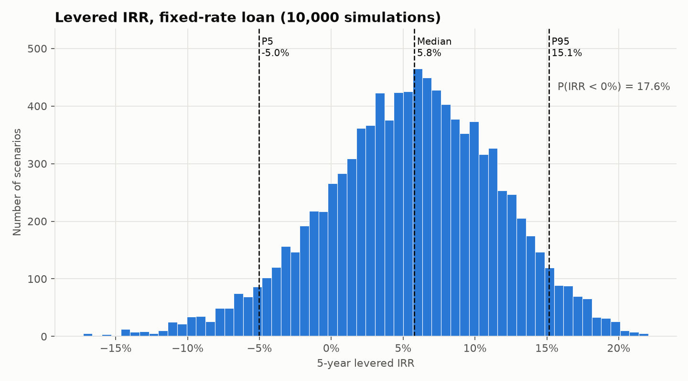
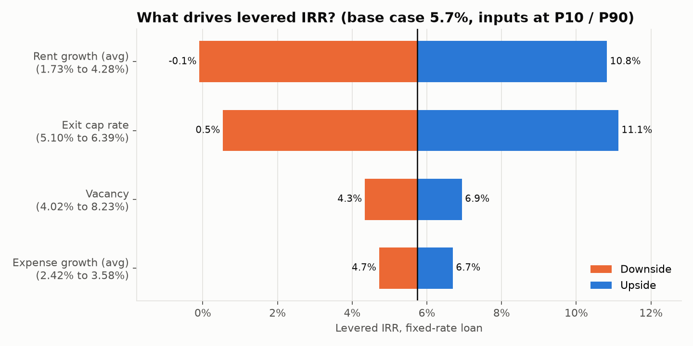
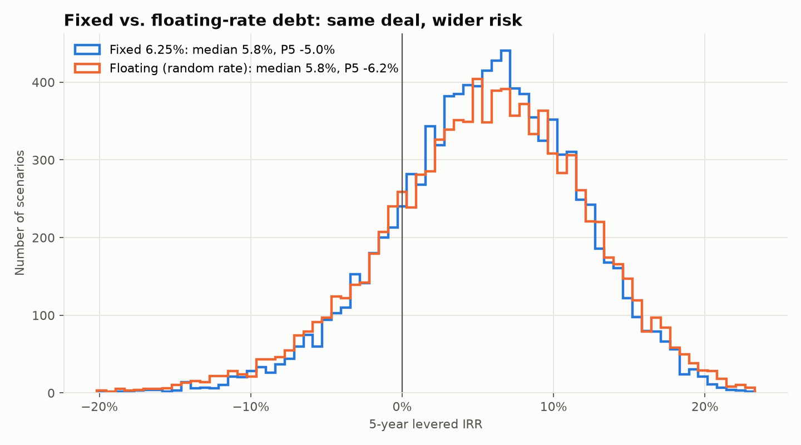

# Monte Carlo Risk Analysis: Denver Multifamily Acquisition

A Python model that stress-tests a **$40M, 200-unit Denver apartment acquisition** across **10,000 simulated market scenarios**. Instead of a single IRR from one set of assumptions, it shows the full range of 5-year outcomes and how likely each one is.



## The question

A standard pro forma says: *"At these assumptions, the deal earns X%."* But rent growth, vacancy, expenses, and exit cap rates are all uncertain. This project answers:

- What is the **range** of returns, not just the base case?
- What is the **probability of losing money**?
- **Which assumption** matters most?
- How much risk does **floating-rate debt** add?

## Key findings

| | Base case | Simulated median | P5 (bad case) | P95 (good case) |
|---|---|---|---|---|
| Levered IRR (fixed-rate loan) | 5.7% | 5.8% | -5.0% | 15.1% |
| Unlevered IRR | 6.0% | 6.0% | 2.4% | 10.0% |
| Equity multiple | 1.31x | 1.32x | 0.78x | 1.99x |

| Probability | Fixed-rate loan | Floating-rate loan | No loan |
|---|---|---|---|
| IRR < 0% (lose money) | **17.6%** | **20.1%** | 0.2% |
| IRR < 10% | 76.2% | 74.7% | 94.9% |
| IRR > 15% | 5.3% | 6.8% | 0.0% |

1. **Negative leverage.** The deal buys at a 5.35% going-in cap rate but borrows at 6.25%. Debt costs more than the property yields, so leverage **lowers** the base-case IRR (5.7% levered vs. 6.0% unlevered) and adds risk. Year 1 DSCR is only 1.11x.
2. **About a 1-in-6 chance of losing equity.** Unlevered, the property almost never loses money (0.2%). With 65% leverage, that rises to 17.6%. Debt magnifies losses more than gains.
3. **Exit cap rate and rent growth drive the outcome.** Moving either one from its 10th to its 90th percentile swings levered IRR by about 11 points. Vacancy and expense growth each move it by only 2-3 points.
4. **Floating-rate debt widens both tails.** The median IRR stays the same, but the chance of a loss rises from 17.6% to 20.1%, and the P5 IRR falls from -5.0% to -6.2%. Because rates and exit caps are correlated, a rate spike hurts twice: higher debt service *and* a lower sale price.

| Tornado: what moves IRR | Fixed vs. floating debt |
|---|---|
|  |  |

## How it works

**1. Pro forma** ([src/model.py](src/model.py)): a standard annual multifamily model.
Gross potential rent → less vacancy, plus other income → EGI → less opex → NOI → less capex reserve and debt service → cash flow to equity. Sale at the end of Year 5 = Year 6 NOI ÷ exit cap, less 2% selling costs, less loan payoff.

**2. Random inputs** ([src/simulate.py](src/simulate.py)): each one gets a distribution chosen to fit its real-world behavior.

| Variable | Distribution | Why |
|---|---|---|
| Rent growth | Normal (3%, 1.5% std), drawn yearly, **autocorrelated** (ρ = 0.5) | Markets run in cycles. Independent yearly draws would cancel out and understate risk. |
| Vacancy | **Beta** scaled to 3%-12%, mean 6% | Bounded (it can't fall below normal turnover) and right-skewed (spikes in downturns). |
| Expense growth | Normal (3%, 1% std), drawn yearly | Tracks inflation, with less noise than rents. |
| Exit cap rate | Normal (5.75%, 0.5% std) | Correlated **+0.6** with interest rates: higher rates push buyers' required cap rates up. |
| Interest rate | Normal (6.25%, 0.75% std) | Sets debt service in the floating-rate version and moves the exit cap. |

**3. Vectorized simulation:** all 10,000 scenarios are numpy arrays (one row per scenario), so the full simulation runs in seconds with no Python loop over scenarios. The same code also runs the single base case, so the simulation and the Excel tie-out use identical math.

**4. Validation** ([tests/test_base_case.py](tests/test_base_case.py)): the base case is rebuilt by hand with `numpy_financial` and must match the model's IRR to within 0.0001 basis points.

## Outputs

| File | What's in it |
|---|---|
| `outputs/summary.xlsx` | Summary stats, probabilities, base-case annual pro forma, tornado, driver correlations, and all assumptions, each on its own sheet. Ready to link to an Excel model. |
| `outputs/simulation_results.csv` | All 10,000 scenarios: every input drawn and every resulting return. |
| `outputs/charts/*.png` | IRR histogram, equity multiple histogram, tornado, fixed vs. floating. |

## Run it

```bash
python3 -m venv .venv && source .venv/bin/activate
pip install -r requirements.txt
python main.py                    # base case + simulation + all outputs
python tests/test_base_case.py    # sanity check vs. hand calculation
```

To model a different deal, edit [assumptions.yaml](assumptions.yaml) (price, rents, loan terms, distributions, seed) and rerun. No code changes needed.

## Simplifications

- Annual periods, with no lease-up or renovation plan; capex reserve is held flat.
- No loan fees, reserves, or refinancing; the loan term matches the 5-year hold.
- In the floating-rate version, the rate is drawn once per scenario (one rate environment for the whole hold), not re-drawn each year.
- The tornado is one-at-a-time sensitivity on the fixed-rate case. Interest rates affect that case only through the exit cap, which the driver-correlation sheet in the Excel file captures.

---
*Built with Python, numpy, pandas, matplotlib, and numpy-financial.*
